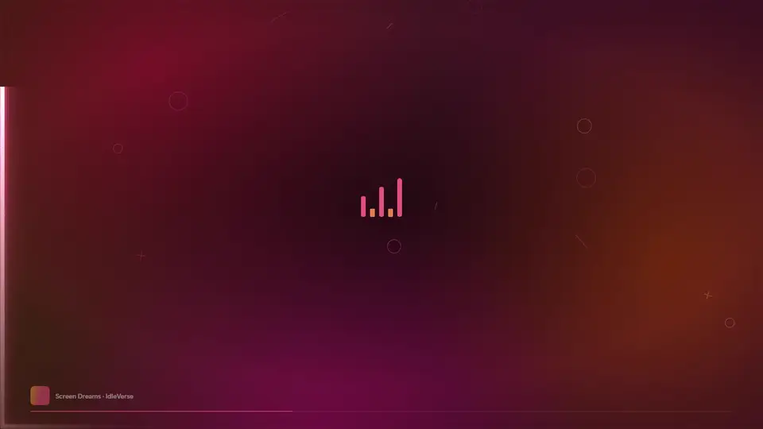
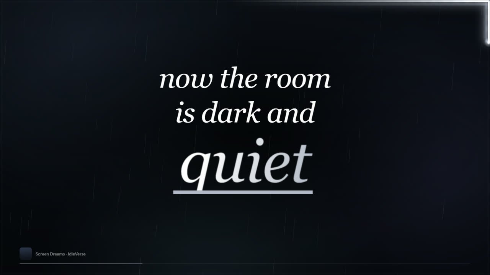
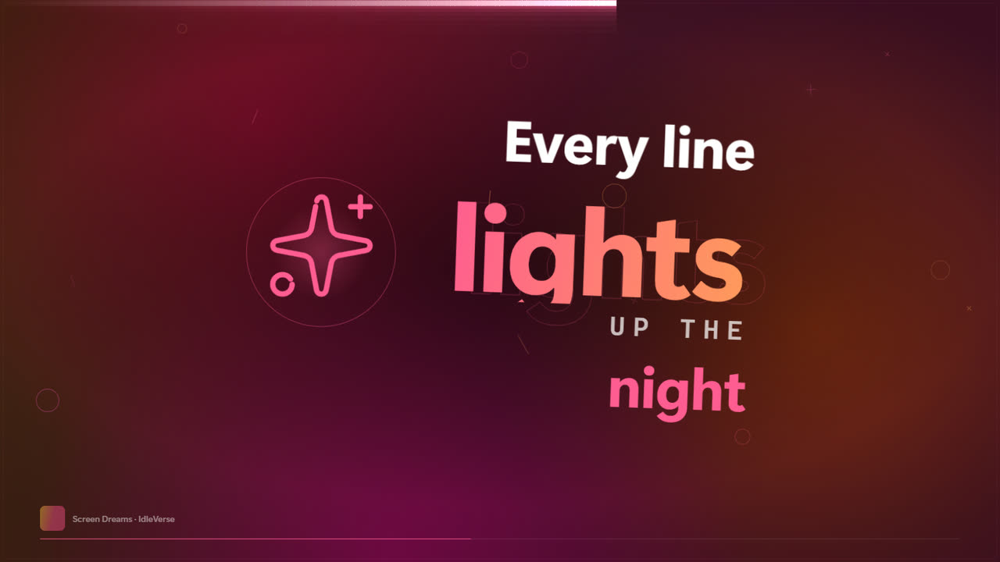
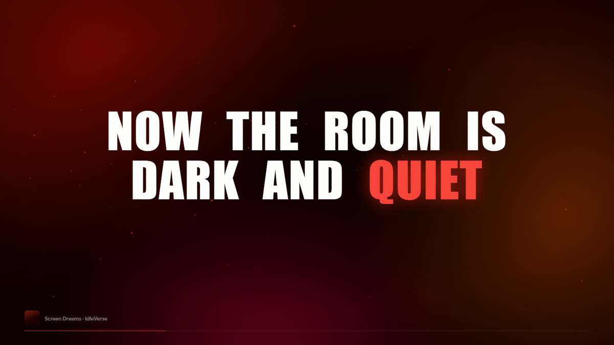
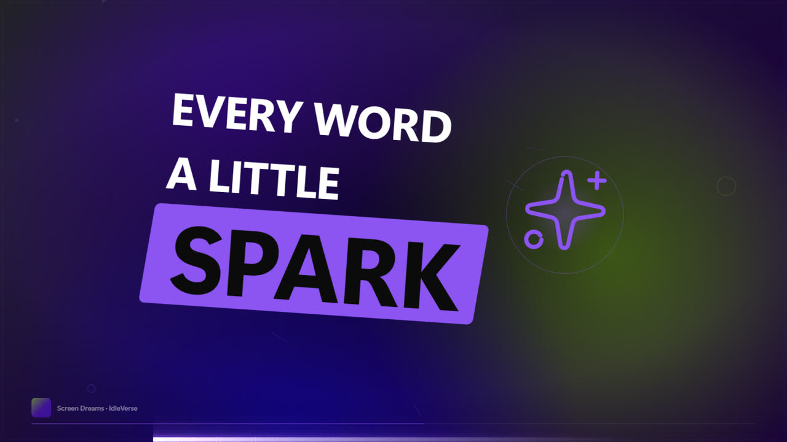
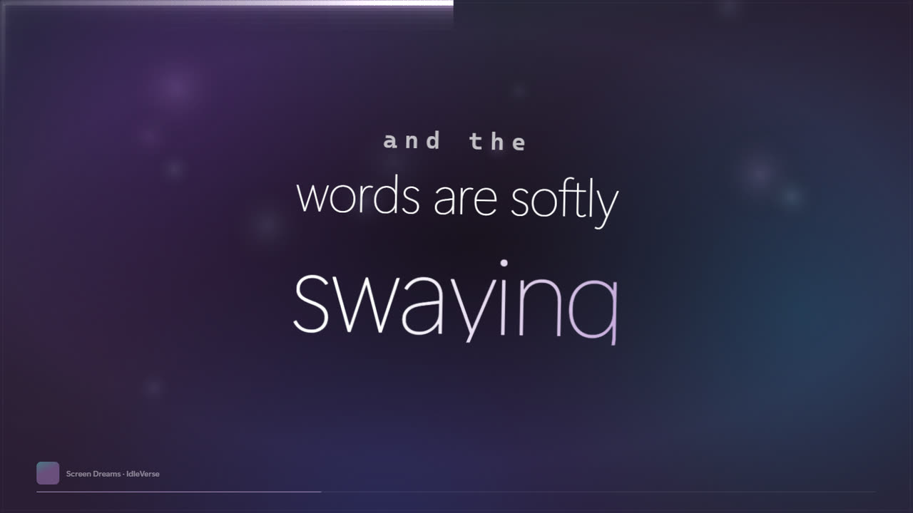
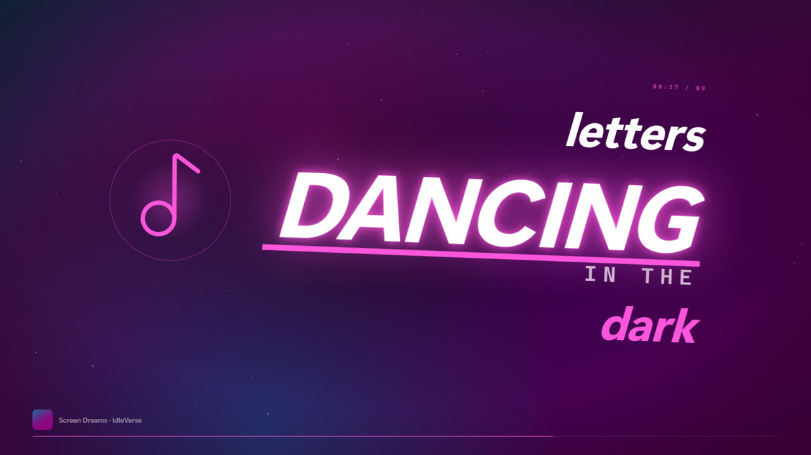
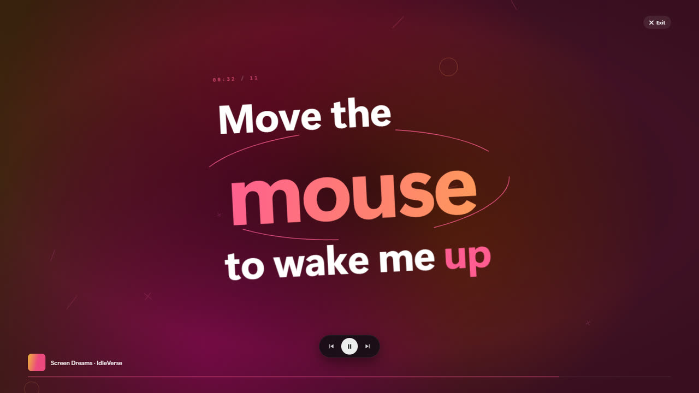
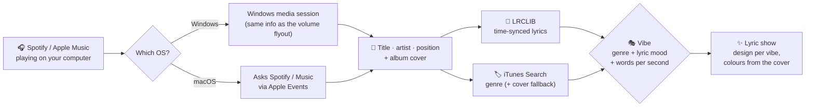

<div align="center">


<br><br>


<br>

**Step away from your desk and your screen becomes a lyric show.**<br>
IdleVerse detects whatever's playing in Spotify or Apple Music, reads the song's vibe and album colours,
turns your display dark to save power, and shows the lyrics live, synced and animated word by word.

<br>

[](https://github.com/janakrathi/IdleVerse/releases/latest)
[](#-install)
[](#-install)
[](LICENSE)

[**Install**](#-install) · [**Features**](#-features) · [**Vibes**](#-six-vibes) · [**Controls**](#-controls) · [**How it works**](#-how-it-works) · [**FAQ**](#-faq) · [**Code signing policy**](#-code-signing-policy)

<br>



<sub>The built-in demo song (original lyrics), recorded straight from the app.</sub>

</div>

<br>

## ✦ Features

<table>
<tr>
<td width="50%" valign="top">

**🎧 &nbsp;Just works with your music**<br>
Spotify and Apple Music on Windows and Mac. No logins, no API keys, no setup. It reads what your music app is already playing.

</td>
<td width="50%" valign="top">

**⏱️ &nbsp;Synced to the beat**<br>
Lyrics are time-synced, and each word appears as it's sung. If the timing is a little off, tap <kbd>[</kbd> <kbd>]</kbd> to nudge it.

</td>
</tr>
<tr>
<td valign="top">

**🎭 &nbsp;Reads the song's vibe**<br>
Sad ballad, rock anthem, hip-hop banger, dance track? IdleVerse works it out from the genre, the lyrics and how fast the words come, then picks a design to match.

</td>
<td valign="top">

**🖼️ &nbsp;Album-art colours**<br>
It pulls the album cover and builds the whole colour theme from it, so every song looks like its own artwork.

</td>
</tr>
<tr>
<td valign="top">

**⏯️ &nbsp;Playback controls**<br>
Move the mouse and a control bar slides in: previous, play / pause, next. It works with Spotify and Apple Music.

</td>
<td valign="top">

**🌍 &nbsp;Any language**<br>
English, Hindi, Punjabi, Spanish, Korean and more. Words are animated whole, so every script renders properly.

</td>
</tr>
<tr>
<td valign="top">

**🌑 &nbsp;Power-saver dark**<br>
Near-black backgrounds mean OLED pixels stay mostly off. Pause the music and it steps aside so your screen can sleep.

</td>
<td valign="top">

**🛡️ &nbsp;Burn-in safe**<br>
The text drifts a few pixels every 30 seconds, so nothing stays in one place long enough to burn in.

</td>
</tr>
</table>

<br>

## ✦ Six vibes

Every song gets the design that fits it, and the backlight, glow and accents are all taken from its own album cover. The vibe is worked out quietly in the background; nothing is labelled on screen. To choose a design yourself, use the tray menu or press <kbd>V</kbd>.

<sub>Shown with the built-in demo song and six sample covers, so you can see the colours follow the artwork.</sub>

<table>
<tr>
<td width="50%"><p align="center"><b>😢 Sad</b> · italic serif, words fade in out of the blur, slow rain</p></td>
<td width="50%"><p align="center"><b>😄 Happy</b> · bouncy, colourful words with confetti on every line</p></td>
</tr>
<tr>
<td><p align="center"><b>🤘 Intense</b> · heavy capitals slam in and the screen shakes, rising embers</p></td>
<td><p align="center"><b>🔥 Hype</b> · left-aligned captions, the current word boxed in colour</p></td>
</tr>
<tr>
<td><p align="center"><b>☁️ Dreamy</b> · light lowercase floating at different heights, soft glowing orbs</p></td>
<td><p align="center"><b>⚡ Electric</b> · neon tubes flicker on and the background pulses on the beat</p></td>
</tr>
</table>

| The song is… | You get |
|---|---|
| Rock, metal, punk | 🤘 Intense |
| Hip-hop / rap (fast flow) | 🔥 Hype |
| Dance, electronic, house | ⚡ Electric |
| Pop, Latin, K-pop (upbeat) | 😄 Happy |
| R&B, soul, acoustic, indie, slow songs | ☁️ Dreamy |
| Any genre with heartbroken lyrics or a slow ballad | 😢 Sad |

<br>

<p align="center"><br><sub>Move the mouse and the playback bar appears.</sub></p>

<br>

## ✦ Install

> [!TIP]
> Grab the latest installer from the **[Releases page](https://github.com/janakrathi/IdleVerse/releases/latest)**. No coding needed.

<details open>
<summary><b>&nbsp;🪟 &nbsp;Windows 10 / 11</b></summary>

<br>

1. Download **`IdleVerse-Setup-x.x.x.exe`** from [Releases](https://github.com/janakrathi/IdleVerse/releases/latest).
2. Open it. If Windows shows **"Windows protected your PC"**, click **More info → Run anyway**. This appears because the app isn't code-signed yet.
3. Finish the installer. IdleVerse launches and its round purple icon appears in your system tray (look under the **^** arrow next to the clock).
4. Play something in **Spotify** or **Apple Music**, then click the tray icon to see it in action.
5. Next time, just press the **Windows key** and type **IdleVerse**, or use the desktop shortcut. To have it start by itself, right-click the tray icon and tick **Open at login**.

</details>

<details open>
<summary><b>&nbsp;🍎 &nbsp;macOS (Apple Silicon & Intel)</b></summary>

<br>

1. Download the right **`.dmg`** from [Releases](https://github.com/janakrathi/IdleVerse/releases/latest):
   - **`mac-arm64`** for M1, M2, M3 or M4 Macs
   - **`mac-x64`** for older Intel Macs
2. Open the `.dmg` and drag **IdleVerse** into **Applications**.
3. The first time, **right-click IdleVerse → Open → Open**, because the app isn't notarized yet.<br>
   If macOS says the app *"is damaged"*, run this once in Terminal:
   ```bash
   xattr -cr /Applications/IdleVerse.app
   ```
4. The IdleVerse icon appears in your menu bar. When asked, **allow IdleVerse to control Spotify / Music**; that's how it reads the current song. Next time, open it with **Spotlight** (⌘ Space, type *IdleVerse*).

</details>

<details>
<summary><b>&nbsp;🛠️ &nbsp;Run from source (developers)</b></summary>

<br>

You need [Node.js](https://nodejs.org) 18 or newer.

```bash
git clone https://github.com/janakrathi/IdleVerse.git
cd idleverse
npm install
npm start          # runs in the tray / menu bar
npm run demo       # preview with the built-in demo song
```

Build your own installers:

```bash
npm run dist:win   # on Windows -> dist/IdleVerse-Setup-x.x.x.exe
npm run dist:mac   # on a Mac   -> dist/IdleVerse-x.x.x-mac-*.dmg
```

Pushing a tag like `v1.2.0` makes GitHub Actions build both installers and attach them to a release automatically.

</details>

<br>

## ✦ Controls

| | |
|---|---|
| **Click the tray / menu-bar icon** | Show the lyrics right now |
| **Right-click the icon** | Settings: idle time, lyric design, keep screen on, launch at login, demo song |
| **Move the mouse** | Show the playback bar (previous · play / pause · next) and the Exit button |
| <kbd>Space</kbd> | Play / pause |
| <kbd>←</kbd> &nbsp;<kbd>→</kbd> | Previous / next song |
| <kbd>[</kbd> &nbsp;<kbd>]</kbd> | Lyrics early or late? Shift them 0.25s (remembered) |
| <kbd>V</kbd> | Cycle the design: auto → sad → happy → intense → hype → dreamy → electric |
| <kbd>Esc</kbd>, **Exit**, or **click empty space** | Close the lyric show |

<br>

## ✦ How it works



| Piece | Where it lives |
|---|---|
| Tray app, idle detection, power handling | [`src/main.js`](src/main.js) |
| "What's playing" detection + play / pause / skip | [`src/detectors/`](src/detectors) |
| Lyric lookup and LRC parsing | [`src/lyrics.js`](src/lyrics.js) |
| Genre and album-art lookup | [`src/meta.js`](src/meta.js) |
| Vibe detection | [`src/vibe.js`](src/vibe.js) |
| The six designs, album colours, controls | [`src/renderer/`](src/renderer) |

Built with [Electron](https://www.electronjs.org). Lyrics are provided by [LRCLIB](https://lrclib.net), a free, open lyrics database; genres by the iTunes Search API.

<br>

## ✦ FAQ

<details>
<summary><b>Do I need a Spotify Premium or Apple Music account?</b></summary>
<br>
No. Any account works. IdleVerse reads what the desktop app is playing; it never logs in to anything.
</details>

<details>
<summary><b>Does it work with music playing on my phone?</b></summary>
<br>
Not yet. It reads the music app on the same computer. Phone or speaker playback via Spotify Connect is on the roadmap.
</details>

<details>
<summary><b>Some songs say "no lyrics found"</b></summary>
<br>
LRCLIB has a huge catalogue, but it doesn't cover everything, especially very new or niche tracks. You still get the song title with animated notes.
</details>

<details>
<summary><b>Will it stop my screen from ever sleeping?</b></summary>
<br>
Only while music is actually playing and the lyrics are on screen. Pause for 2 minutes and IdleVerse closes, so your normal sleep settings take over. You can also turn off <i>Keep screen on while lyrics show</i> in the tray menu.
</details>

<details>
<summary><b>What data does it send anywhere?</b></summary>
<br>
Only the song's title, artist, album and length: to LRCLIB to look up lyrics, and to Apple's iTunes Search to look up the genre and cover art. Nothing else, no analytics, no accounts. You can switch either lookup off from the tray menu → <b>Privacy</b>. Details are in the <a href="PRIVACY.md">privacy policy</a>.
</details>

<details>
<summary><b>The vibe is wrong for a song</b></summary>
<br>
The guess comes from the genre, the lyric words and how fast they're sung, so it's occasionally off. Press <kbd>V</kbd> on the lyric screen, or pick a design in the tray menu under <i>Lyric design</i>, to choose one yourself.
</details>

<br>

## ✦ Roadmap

- [x] Album-art colour palettes
- [x] Vibe-matched lyric designs
- [x] Playback controls on the lyric screen
- [ ] Spotify Connect support (lyrics for music playing on your phone or speakers)
- [ ] Real audio analysis (tempo / energy) for even better vibe matching
- [ ] Multi-monitor mode
- [ ] Signed and notarized installers
- [ ] More animation moods

Ideas and pull requests are very welcome. [Open an issue](https://github.com/janakrathi/IdleVerse/issues).

<br>

## ✦ Code signing policy

Free code signing provided by [SignPath.io](https://about.signpath.io), certificate by [SignPath Foundation](https://signpath.org).

Windows releases are built from this repository's source by [GitHub Actions](.github/workflows/release.yml) and signed through SignPath only after a maintainer manually approves each release.

| Role | Members |
|---|---|
| Committers and reviewers | [@janakrathi](https://github.com/janakrathi) |
| Approvers | [@janakrathi](https://github.com/janakrathi) |

Pull requests from anyone outside this list are reviewed by a committer before they are merged.

**Privacy:** IdleVerse sends the current song's title, artist, album and length to [LRCLIB](https://lrclib.net) (lyrics) and its title and artist to Apple's iTunes Search API (genre and cover art). It sends nothing else, and both lookups can be switched off in the app. See the full [privacy policy](PRIVACY.md).

<br>

<div align="center">

<sub>IdleVerse is an independent project and is not affiliated with, endorsed by, or sponsored by Spotify or Apple.<br>
Lyrics come from the community-run <a href="https://lrclib.net">LRCLIB</a> and belong to their respective rights holders.</sub>

<br><br>

<sub>Made with ♪ by <a href="https://github.com/janakrathi">@janakrathi</a> · MIT License</sub>

</div>
