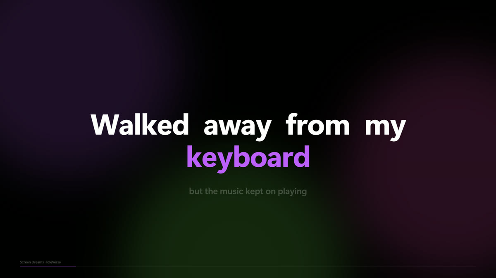
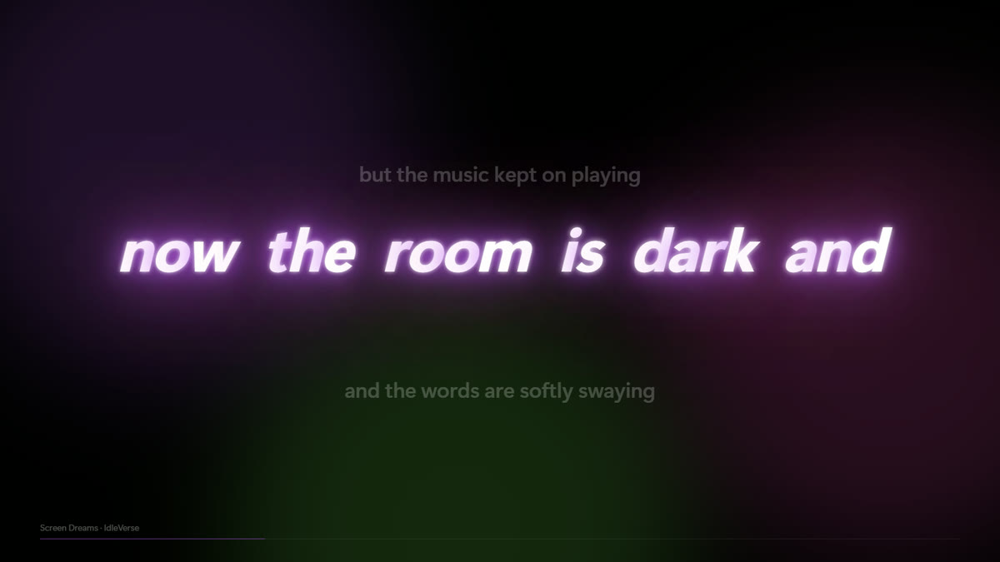
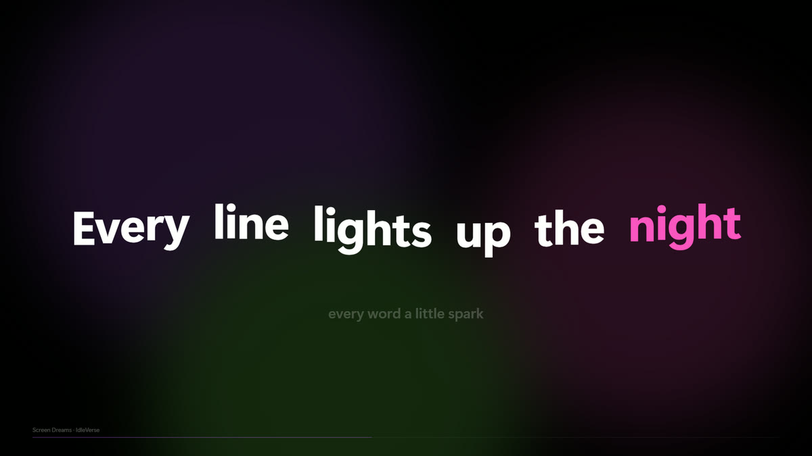
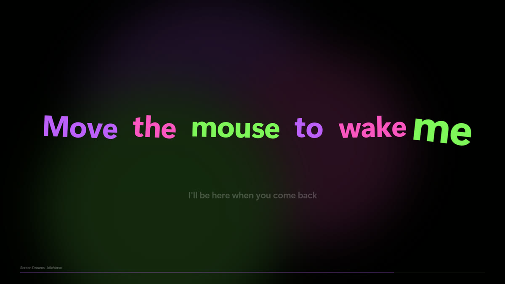
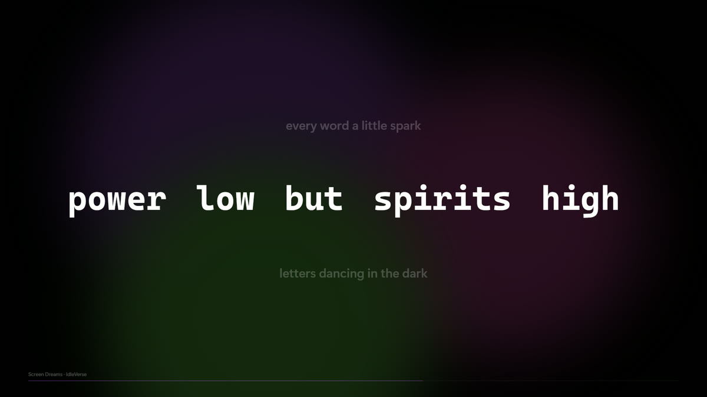
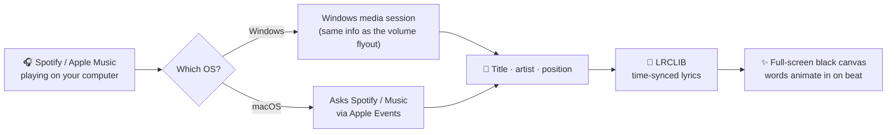

<div align="center">



<br>

**Step away from your desk and your screen becomes a lyric show.**<br>
IdleVerse detects whatever's playing in Spotify or Apple Music, turns your display pitch-black
to save power, and shows the lyrics live, synced to the beat and animated word by word.

<br>

[](https://github.com/janakrathi/idleverse/releases/latest)
[](#-install)
[](#-install)
[](LICENSE)

[**Install**](#-install) · [**Features**](#-features) · [**Styles**](#-five-moods) · [**Controls**](#-controls) · [**How it works**](#-how-it-works) · [**FAQ**](#-faq)

<br>


<sub>The built-in demo song (original lyrics), recorded straight from the app.</sub>

</div>

<br>

## ✦ Features

<table>
<tr>
<td width="50%" valign="top">

**🎧 &nbsp;Just works with your music**<br>
Spotify and Apple Music on Windows and Mac. No logins, no API keys, no setup. It reads what your music app is already playing.

</td>
<td width="50%" valign="top">

**⏱️ &nbsp;Synced to the beat**<br>
Lyrics are time-synced, and each word appears as it's sung. If the timing is a little off, tap <kbd>←</kbd> <kbd>→</kbd> to nudge it.

</td>
</tr>
<tr>
<td valign="top">

**🌑 &nbsp;Power-saver black**<br>
A true-black background means OLED pixels switch off and LCDs dim. Pause the music and it steps aside so your screen can sleep.

</td>
<td valign="top">

**💤 &nbsp;Starts when you leave**<br>
Walk away for a minute (you choose how long) and the lyric show begins. Move the mouse and you're back where you left off.

</td>
</tr>
<tr>
<td valign="top">

**🎨 &nbsp;Five animation moods**<br>
Bounce, Neon, Wave, Typewriter and Pop, or *Mix* them line by line. Every song gets its own colour palette.

</td>
<td valign="top">

**🛡️ &nbsp;Burn-in safe**<br>
The text drifts a few pixels every 30 seconds, so nothing stays in one place long enough to burn in.

</td>
</tr>
</table>

<br>

## ✦ Five moods

<table>
<tr>
<td width="50%"><p align="center"><b>Bounce</b> · words drop in with a spring</p></td>
<td width="50%"><p align="center"><b>Neon</b> · flickers on like a sign</p></td>
</tr>
<tr>
<td><p align="center"><b>Wave</b> · letters ride a gentle swell</p></td>
<td><p align="center"><b>Pop</b> · confetti-coloured and a bit tilted</p></td>
</tr>
<tr>
<td colspan="2"><p align="center"><b>Typewriter</b> · typed out letter by letter, cursor and all</p></td>
</tr>
</table>

<br>

## ✦ Install

> [!TIP]
> Grab the latest installer from the **[Releases page](https://github.com/janakrathi/idleverse/releases/latest)**. No coding needed.

<details open>
<summary><b>&nbsp;🪟 &nbsp;Windows 10 / 11</b></summary>

<br>

1. Download **`IdleVerse-Setup-x.x.x.exe`** from [Releases](https://github.com/janakrathi/idleverse/releases/latest).
2. Open it. If Windows shows **"Windows protected your PC"**, click **More info → Run anyway**. This appears because the app isn't code-signed yet.
3. Finish the installer. IdleVerse launches and a ♪ icon appears in your system tray (look under the **^** arrow next to the clock).
4. Play something in **Spotify** or **Apple Music**, then click the tray icon to see it in action.

</details>

<details open>
<summary><b>&nbsp;🍎 &nbsp;macOS (Apple Silicon & Intel)</b></summary>

<br>

1. Download the right **`.dmg`** from [Releases](https://github.com/janakrathi/idleverse/releases/latest):
   - **`mac-arm64`** for M1, M2, M3 or M4 Macs
   - **`mac-x64`** for older Intel Macs
2. Open the `.dmg` and drag **IdleVerse** into **Applications**.
3. The first time, **right-click IdleVerse → Open → Open**, because the app isn't notarized yet.<br>
   If macOS says the app *"is damaged"*, run this once in Terminal:
   ```bash
   xattr -cr /Applications/IdleVerse.app
   ```
4. A ♪ icon appears in your menu bar. When asked, **allow IdleVerse to control Spotify / Music**; that's how it reads the current song.

</details>

<details>
<summary><b>&nbsp;🛠️ &nbsp;Run from source (developers)</b></summary>

<br>

You need [Node.js](https://nodejs.org) 18 or newer.

```bash
git clone https://github.com/janakrathi/idleverse.git
cd idleverse
npm install
npm start          # runs in the tray / menu bar
npm run demo       # preview with the built-in demo song
```

Build your own installers:

```bash
npm run dist:win   # on Windows -> dist/IdleVerse-Setup-x.x.x.exe
npm run dist:mac   # on a Mac   -> dist/IdleVerse-x.x.x-mac-*.dmg
```

Pushing a tag like `v1.2.0` makes GitHub Actions build both installers and attach them to a release automatically.

</details>

<br>

## ✦ Controls

| | |
|---|---|
| **Click the tray / menu-bar icon** | Show the lyrics right now |
| **Right-click the icon** | Settings: idle time, style, keep screen on, launch at login, demo song |
| <kbd>←</kbd> &nbsp;<kbd>→</kbd> | Lyrics early or late? Shift them 0.25s (remembered) |
| <kbd>S</kbd> | Cycle animation style |
| **Move the mouse / any other key** | Close the lyric show |

<br>

## ✦ How it works



| Piece | Where it lives |
|---|---|
| Tray app, idle detection, power handling | [`src/main.js`](src/main.js) |
| "What's playing" detection | [`src/detectors/`](src/detectors) |
| Lyric lookup and LRC parsing | [`src/lyrics.js`](src/lyrics.js) |
| The animated lyric screen | [`src/renderer/`](src/renderer) |

Built with [Electron](https://www.electronjs.org). Lyrics are provided by [LRCLIB](https://lrclib.net), a free, open lyrics database.

<br>

## ✦ FAQ

<details>
<summary><b>Do I need a Spotify Premium or Apple Music account?</b></summary>
<br>
No. Any account works. IdleVerse reads what the desktop app is playing; it never logs in to anything.
</details>

<details>
<summary><b>Does it work with music playing on my phone?</b></summary>
<br>
Not yet. It reads the music app on the same computer. Phone or speaker playback via Spotify Connect is on the roadmap.
</details>

<details>
<summary><b>Some songs say "no lyrics found"</b></summary>
<br>
LRCLIB has a huge catalogue, but it doesn't cover everything, especially very new or niche tracks. You still get the song title with animated notes.
</details>

<details>
<summary><b>Will it stop my screen from ever sleeping?</b></summary>
<br>
Only while music is actually playing and the lyrics are on screen. Pause for 2 minutes and IdleVerse closes, so your normal sleep settings take over. You can also turn off <i>Keep screen on while lyrics show</i> in the tray menu.
</details>

<details>
<summary><b>What data does it send anywhere?</b></summary>
<br>
Only the song title, artist, album and length, sent to LRCLIB to look up lyrics. Nothing else, no analytics, no accounts.
</details>

<br>

## ✦ Roadmap

- [ ] Spotify Connect support (lyrics for music playing on your phone or speakers)
- [ ] Album-art colour palettes
- [ ] Multi-monitor mode
- [ ] Signed and notarized installers
- [ ] More animation moods

Ideas and pull requests are very welcome. [Open an issue](https://github.com/janakrathi/idleverse/issues).

<br>

<div align="center">

<sub>IdleVerse is an independent project and is not affiliated with, endorsed by, or sponsored by Spotify or Apple.<br>
Lyrics come from the community-run <a href="https://lrclib.net">LRCLIB</a> and belong to their respective rights holders.</sub>

<br><br>

<sub>Made with ♪ by <a href="https://github.com/janakrathi">@janakrathi</a> · MIT License</sub>

</div>
